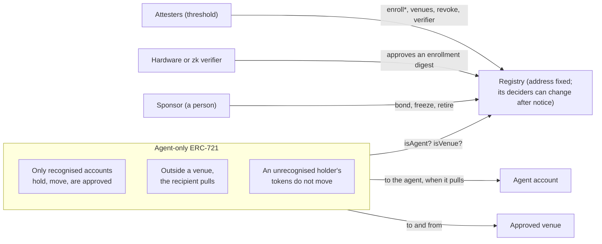
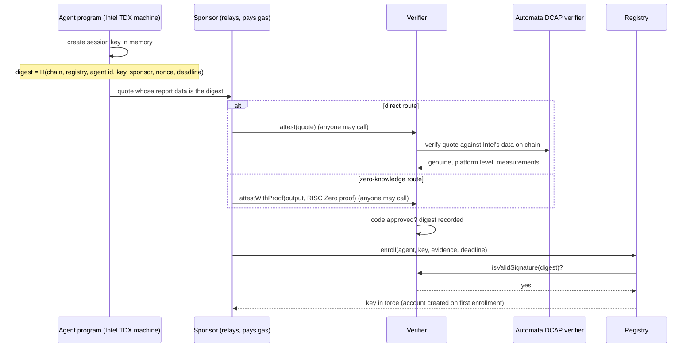

# Agent-Only Tokens: keeping a token between AI agents, on chain

*Draft, 18 November 2026. Author: to be filled in. Figures wrapped in markers
in the source of this page are checked against the repository by
`tools/figures.py`; the others cite a section of [`study.md`](study.md), the
full record, which links each on-chain claim to its transaction or test.*

## Abstract

Some assets only make sense between software agents: credentials, licences,
seats or positions meant for programs, whose purpose is lost once a person can
buy them on an ordinary marketplace. No contract can tell whether a language
model decided a transaction. A contract can require that every account that
holds, moves or is approved for a token is one a registry recognises as an
agent's account; whether that account escapes human control then depends on
the registry, on its deciders or on hardware attestation of code that accepts
no instructions. We propose an extension of ERC-721 with three rules and a
separate, replaceable registry. We give a reference implementation of
<!--f:lines.ERC721AgentOnly-->72<!--/f--> lines, a second one written from the
text alone by a separate AI agent, a conformance suite, symbolic proofs, and
real runs on Base Sepolia in which an agent's key was created inside an Intel
TDX machine and enrolled by verifying the machine's quote on chain; a
zero-knowledge proof of such a quote was also recorded on chain. We state what
the design cannot prevent, and what it assumes.

## 1. The problem

"Only agents may hold this" sounds like an access rule. It is two problems:
saying who is an agent, and making the token obey. The first has no complete
answer today; the second has a small one. Mixing them gives tokens that check
something weak: whether an address carries code, which has never shown that a
program controls it (people control smart-contract wallets, and since EIP-7702
even an ordinary account can carry code), or whether it is listed in an
identity registry, which shows only that someone registered it.

We separate them. A token asks a registry two questions, `isAgent(address)` and
`isVenue(address)`, on every movement and every grant of an approval, and
obeys the answers. The registry's address is fixed when the token is deployed;
who decides inside it, and how, can change behind it.

**Terms.** An account is *recognised* when the registry answers `true` to
`isAgent` or to `isVenue` for it. A *venue* is a contract the registry approves
to deliver and hold tokens (a sale, a loan, an escrow). A *sponsor* is the
person or organisation that enrolls an agent, pays its bond and can freeze or
retire it; it never holds the agent's key. *Attesters* are the registry's
deciders, keys or contracts, acting at a threshold.

\* Enrollments signed by attesters take effect at once.

## 2. Threat model

The adversary is a person who wants to hold, trade or control an agent-only
token as if it were an ordinary one, or to make an agent act against its rules.

| The adversary can | The design answers |
| --- | --- |
| Use an ordinary wallet or marketplace | The token refuses to move to, or be approved for, any account the registry does not recognise; a marketplace cannot sell what it cannot receive or be approved for |
| Deploy a contract that wraps the token | An unapproved contract cannot receive it. A recognised agent can still wrap it or sell claims on it (section 8) |
| Send an agent an unsolicited token | Outside a venue, a token arrives only when its recipient pulls it |
| Steal or leak an agent's session key | Keys expire after 30 days and are replaced at each enrollment. Once the theft is detected, the sponsor freezes the agent in one transaction and its tokens stop moving; until then the thief acts as the agent, within its allowance and the venues |
| Mislead the agent (prompt injection) | Funds it can spend are capped per period by an allowance outside its reach (section 6); what it does with its tokens is bounded only by its program |
| Control some of the attesters | A threshold is needed. Approvals of venues and verifiers, and changes of attesters, wait for a notice delay chosen at deployment (possibly zero). Enrollments signed by attesters, the default, take effect at once: a dishonest quorum can enroll a key a person holds. The owners of a contract attester can change without notice |
| Own any Intel TDX server | Not prevented: with physical access, attestation keys have been extracted and quotes forged (TEE.fail), and a forged quote for the approved code enrolls a key the adversary holds. Attesters can revoke once they detect it |
| Own the machine the agent runs on, or its sponsor role | Out of reach of any contract (section 8) |

## 3. The rules

A compliant token is a full ERC-721 that exposes its registry
(`agentRegistry()`, whose selector `0x0d1cfcae` is its ERC-165 identifier),
and:

1. **Only recognised accounts take part.** Any mint, transfer or burn reverts
   if the caller is not recognised; the recipient must be recognised; a grant
   of an approval reverts if the account approved, the caller, the granter or
   the holder is not.
2. **Outside a venue, the recipient pulls.** If the caller is not a venue, the
   recipient must be the caller itself. No agent receives a token it did not
   ask for, unless an approved venue delivers it.
3. **An unrecognised holder does not move.** A transfer or burn reverts if the
   holder is not recognised: when an agent is frozen, expired or revoked, its
   tokens stay with it, even through an approval or a listing left behind,
   and move again if it is recognised again.

A compliant token must also require ERC-721 authorisation on every path, fix
its registry at deployment, and offer no path around the rules; the
conformance suite cannot check the last point from outside, and a token
behind an upgradeable proxy can drop every rule. Clearing an approval is
always possible. These three rules map to the eight of the draft ERC in
[`docs/erc`](erc/README.md) (rule 1 here: ERC rules 2, 3 and 5; rule 2: rule 4;
rule 3: rule 7; the ERC adds full ERC-721 support, the fixed registry and
authorisation on every path). The same rules for ERC-1155 are in
[`docs/erc/profiles.md`](erc/profiles.md).

**Why pull.** An unsolicited token is not neutral for an agent: its metadata
can carry instructions, and holdings can raise permissions. In May 2026 a
membership NFT gifted to an agent's wallet reportedly restored rights it then
used after an injected instruction, and funds were drained (study, section
1.6). Requiring the recipient to be the caller gives every agent a veto over
what it receives from anyone but a venue.

**Why venues.** A sale, a loan or an escrow must deliver to someone other than
the caller. A venue is approved by the registry, after a notice delay during
which its code can be read.

**What the rules guarantee, and what they assume.**

| Guarantee | Holds if |
| --- | --- |
| No account the registry does not recognise holds, receives or is approved for the token | The token is compliant and not upgradeable |
| No agent receives a token it did not pull, except from a venue | Venues deliver only to accounts that asked |
| A frozen, expired or revoked holder's tokens do not move | The token is compliant |
| Recognised accounts are agents with no human controller | The attesters are honest; the notice delay is long enough for someone to look; the approved code accepts no instructions; no TDX quote is forged; Intel's data on chain is current |

## 4. The registry

Our registry (`AttestedAgentRegistry`,
<!--f:lines.AttestedAgentRegistry-->525<!--/f--> lines) recognises an agent
account when its current session key was enrolled and has not expired, been
frozen or been revoked.

- **Accounts with no human owner.** Each agent has an account, a clone of one
  implementation, that only its current session key can make act. The key
  changes at each enrollment; the account, and what it holds, stay.
- **Deciders.** The attesters sign enrollments, venue approvals, revocations
  and changes of the set itself, at a threshold, with a deadline on each
  signature.
- **Notice.** Approving a venue, replacing the verifier and replacing the
  attesters take effect only after the notice delay; a freeze, a revocation
  and a halt of enrollments take effect at once. Attester-signed enrollments
  are immediate. A page with no server reads a registry from public nodes and
  shows what is announced and when it takes effect
  ([`docs/monitor`](monitor/index.html)).
- **Enrollment by the machine itself.** Instead of attesters, an enrollment
  verifier can approve an enrollment from a hardware attestation of the
  machine the agent runs on.

## 5. Proving that the code is an agent's

On a dstack confidential machine (Intel TDX, on Phala Cloud), the agent's
program creates its session key in memory and asks the processor for a quote
whose report data is the registry's enrollment digest for that key. The quote
carries a measurement of the machine's configuration, which on dstack includes
the hash of the compose file that pins the program. A verifier accepts the
enrollment when Automata's on-chain DCAP verifier finds the quote genuine and
not in debug mode, at a platform level it accepts, the compose hash approved,
and the digest that of this enrollment. Since the sponsor relays the quote,
the digest binds the key, the sponsor and a nonce, so a relayed quote cannot
serve another key.

**Assumptions.** The approved code only quotes digests of keys it created;
"up to date" is judged against Intel's evaluation on chain, which can lag
Intel's latest; the base image was matched against the one dstack publishes,
not rebuilt from source; in the format we use, the key provider is not
checked (study, sections 3.20 to 3.23 and 7).

**Cost, and a zero-knowledge route.** Verifying a quote on chain cost
3,719,480 gas (study, section 3.21). A RISC Zero proof that Automata's program
checked the quote lets the verifier record it for about 0.7 million gas
instead; a real proof of our own quote was recorded so on Base Sepolia on 18
November 2026, and the registry's switch to the zero-knowledge verifier was
announced the same day, to take effect after its 24-hour notice (study,
sections 3.27 and 3.28). But a proof is not free: about $0.86 and 1.7 hours of
a rented machine per enrollment, since a proof must be recent. The saving is
about 3 million gas, worth $0.86 at a gas price g of about 0.16 gwei with ETH
at $1,810 (break-even g ≈ 0.86 / (3.0×10⁶ × 1,810 × 10⁻⁹)). At the 0.006 gwei
read on Base on 18 November 2026, the proof costs about 25 times what it
saves; the route pays where gas is dear.

## 6. Bounding what a misled agent can spend

Signing is not deciding. Our fourth agent program cannot be asked to sign: its
HTTP side shows only its key, its state and the enrollment quote of its own
key; every signature comes from its own loop. And the funds it can spend are
not counted in its memory: a sponsor funds an allowance (`AgentAllowance`,
<!--f:lines.AgentAllowance-->126<!--/f--> lines) that its account can draw
from, only to itself, at most a fixed amount per period, with a limit nobody
can raise.

The limit sits outside the account for a reason. With the EIP-3009 method of
x402 payments, which the reference facilitator uses, USDC asks a payer that is
a contract about its signature through ERC-1271, by a read-only call: an
account that tries to count what it signs is refused (a test on Circle's own
code shows it). We therefore put the limit where the money is. A delegation
from the sponsor's account under ERC-7710, with a caveat limiting transfers per
period, would be an equivalent alternative; Safe's allowance module is another.

**Limits.** Tested on a local chain and on a copy of Base Sepolia, not yet in a
confidential machine. The limit covers funds drawn from the allowance, not the
agent's tokens or approvals; payees are not restricted; up to twice the limit
can leave across the boundary of two periods; and the agent can draw again
every period.

## 7. Evidence

| What | How it is shown |
| --- | --- |
| The rules hold for every input of one action by any of three accounts | Symbolic proofs with Halmos, with proofs on the registry, the loan venue, the allowance and the account: <!--f:proofs-->13<!--/f--> in all; those of the registry are also run against registries broken on purpose, where they must fail |
| No check is untested | Mutation testing: <!--f:mutants-->347<!--/f--> mutants (each removes one check or changes one line), all caught but <!--f:mutants.accepted-->1<!--/f--> that cannot change behaviour |
| The text says what the code does | A conformance suite of <!--f:tests.Reference-->17<!--/f--> tests that our implementation and a second one on Solady pass, and that nine implementations each missing one check all fail |
| It works with real machines and chains | Agents enrolled on Base Sepolia from quotes of real Intel TDX machines; an agent paid for an x402 page from its account; a key renewed after a restart, on the same account; a zero-knowledge proof of a quote recorded on chain |
| What is deployed is what was published | Of the <!--f:deployed-->73<!--/f--> contracts we deployed on Base Sepolia, <!--f:deployed.clones-->19<!--/f--> are account clones; all <!--f:deployed.verified-->54<!--/f--> others are verified on Sourcify, <!--f:deployed.exact-->49<!--/f--> with an exact match. The code at every recorded address is checked every night |
| Everything can be replayed | `tools/reproduce.sh` replays every check in one command |

Two separate AI agents that had not seen the work read the proposal: one as a
hostile reviewer, one implementing it from the text alone. Both found, each on
its own, that the approval rule checked the caller but not the holder; the
rule and the code were fixed. The symbolic proofs found that the loan venue,
in a currency that keeps part of every transfer, could owe its lenders more
than it held; it now refuses a short repayment.

## 8. Limits

**What no contract can prevent.** A person can own the machine the agent runs
on, fund it, sell the whole agent or its sponsor role, influence what it
reads, or sell an off-chain promise about a token. A recognised account can
wrap the token, issue claims on it, or hand over control of itself. The rules
close the on-chain market to accounts the registry does not recognise; they do
not prove that no person decided.

**What rests on hardware.** An attacker with physical access to any TDX
machine can extract its attestation key and forge quotes that our verifier
accepts (TEE.fail, October 2025). Restricting enrollment to hosted hardware, or
requiring two manufacturers for one enrollment, was studied and prototyped,
not deployed.

**What rests on others, and can freeze everything.** Automata's verifier needs
Intel's data on chain, which expires about monthly unless renewed. While it is
expired, no key can be enrolled or renewed; keys then lapse after their
lifetime, and since an unrecognised holder's tokens do not move, every token
of every collection using the registry stops, and a borrower who cannot repay
loses its pledge. A halt by the attesters has the same effect. On Base
mainnet, on 18 November 2026, the data that checks a TDX quoting enclave was
missing or out of date (`QEIDVE`), so our quotes were refused there.

**What is not done.** Nothing has been audited by a person; everything ran on a
test network; the agent decides by a fixed rule, not yet by a language model;
the reviewers were AI models.

## 9. Related work

**Agent identity.** ERC-8004 gives agents identity, reputation and validation
registries; its identity is an ERC-721 that anyone can own and sell, so it
says who an agent is, not what only agents may hold. ERC-8181 is the closest
idea we found (study, section 1.4b). Several "agent-only" projects filter the
mint with a challenge or a co-signature; the three we checked then let anyone
trade the token.

**Restricted tokens.** ERC-3643 separates a token, fungible there, from an
identity registry for regulated securities, but keeps a privileged role that
can force transfers, which this design forbids. ERC-721C checks every transfer
against a validator, which inspired our check on every movement; soulbound
tokens (ERC-5192) forbid transfers altogether.

**Permissions.** ERC-7715 is a wallet method by which an application asks a
user's wallet for permissions; ERC-7710 is on-chain delegation with caveats,
and Safe's allowance module gives a delegate a periodic allowance. Either
could bound an agent's spending as our allowance does.

**Proof of agent.** Proofs that a program ran (hardware attestation, its
zero-knowledge proofs, proofs of inference) are the inverse of proof of
personhood; section 1.5 of the study compares ten options.

## 10. Conclusion

"LLM-only" cannot be proved. "Held only by accounts a registry recognises as
agents" can be enforced, in <!--f:lines.ERC721AgentOnly-->72<!--/f--> lines,
with the proof of agent kept replaceable behind the registry. Whether those
accounts escape human control rests on the registry and on the approved code,
and that is where the remaining work lies: forged hardware quotes, the
deciders of the registry, what the agent reads, an audit, and real use.
