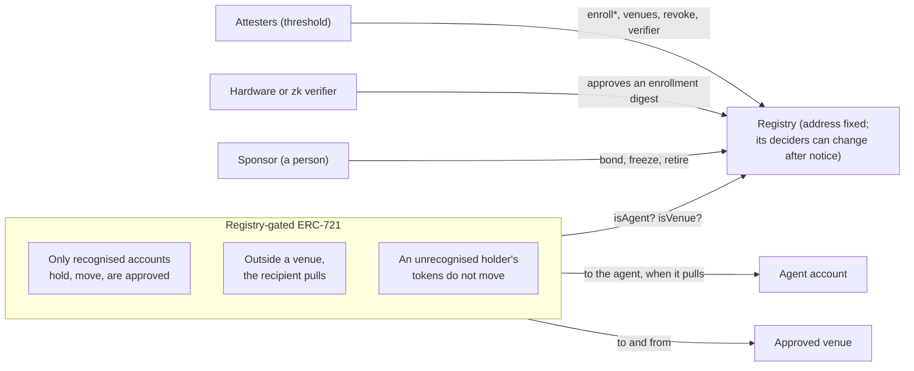
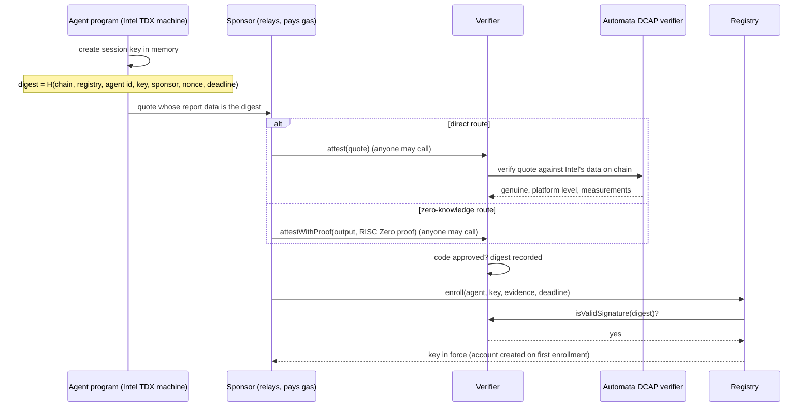

# Gating a token on attested programs: what it takes, and how it breaks

*An experience report. Draft, 23 November 2026. Author: Julien Kervarrec, with an
AI assistant (see "How this was produced" at the end). The repository is still
named "Agent-Only Tokens", the name the project started with; section 2 says why
that name claims too much. Figures wrapped in markers in the source of this page
are checked against the repository by `tools/figures.py`; the others cite a
section of [`study.md`](study.md), the full record, which links each on-chain
claim to its transaction or test.*

## Abstract

We set out to build a token that only AI agents could hold. That cannot be
built: no contract can tell whether a language model decided a transaction,
and nothing we built shows it either. What can be built is narrower: a token
that moves only among accounts whose key was enrolled by a registry, either by
the registry's deciders or after a hardware attestation that the key was
created by an approved program in a confidential machine. A script with no
model qualifies; so does a person who runs the approved program.

This report says what that narrower thing takes and how it broke during ten
days of building it on a test network: an extension of ERC-721 with three rules
and a separate registry, a reference implementation of
<!--f:lines.ERC721AgentOnly-->72<!--/f--> lines, enrollment from real Intel TDX
quotes verified on chain, and seven small programs run in confidential
machines. Along the way a zero-knowledge verifier we had switched to was halted
by its vendor within a day, Intel's data on chain turned out stale on the main
network, the measured field changed format with a new system version, an
independent review stopped our programs with one malformed request, and the
attestation everything rests on had already been forged by others with about
$1,000 of equipment. We report these as the main results.

## 1. The problem

"Only agents may hold this" sounds like an access rule. It is two problems:
saying who is an agent, and making the token obey. The first has no complete
answer today; the second has a small one. Mixing them gives tokens that check
something weak: whether an address carries code, which has never shown that a
program controls it (people control smart-contract wallets, and since EIP-7702
even an ordinary account can carry code), or whether it is listed in an
identity registry, which shows only that someone registered it.

We separate them. A token asks a registry two questions, `isAgent(address)` and
`isVenue(address)`, on every movement and every grant of an approval, and
obeys the answers. The registry's address is fixed when the token is deployed;
who decides inside it, and how, can change behind it.

**The word "agent".** The interfaces say `isAgent`, and this report says
"agent" for an account the registry recognises under that question. It means
no more than that. Section 2 says what recognition shows.

**Terms.** An account is *recognised* when the registry answers `true` to
`isAgent` or to `isVenue` for it. A *venue* is a contract the registry approves
to deliver and hold tokens (a sale, a loan, an escrow). A *sponsor* is the
person or organisation that enrolls an agent, pays its bond and can freeze or
retire it; it never holds the agent's key. *Attesters* are the registry's
deciders, keys or contracts, acting at a threshold.

\* Enrollments signed by attesters take effect at once.

## 2. What recognition shows, and what it does not

A registry recognises an account in one of two ways. Its deciders sign the
enrollment of a key; or a verifier accepts a hardware quote showing that the
key was created by a program on its approved list, in an Intel TDX machine.

Neither shows that a model decides. Of the seven programs we ran, four call no
model at all: they are scripts that draw an allowance, pay for a page or renew
a key. The three that can call one asked it ten yes-or-no questions in all; in
the last runs, of 23 November 2026, the program held a token and used it as a
pass without asking a model anything. A script is an "agent" here.

Neither shows that no person is behind it. A person can hold these tokens while
following every rule, in three ways: the deciders can enroll a key that person
holds; the person can run the approved program themselves, choosing its settings
and what it reads; or the person can forge a quote (section 9).

The strongest claim the mechanism supports is this: **the token moves only
among accounts whose key was enrolled by the registry, and, on the attested
route, was created by a program on the registry's approved list inside a
confidential machine; outside a venue it is received only by pulling.** What
that is worth depends on who keeps the list and on the hardware. The same was
said of a related construction: an attestation shows that a guardrail ran, not
that it makes the agent safe (Jin et al., arXiv:2603.05786).

## 3. Threat model

The adversary is a person who wants to hold, trade or control such a token as
if it were an ordinary one, or to make an enrolled program act against its
rules.

| The adversary can | The design answers |
| --- | --- |
| Use an ordinary wallet or marketplace | The token refuses to move to, or be approved for, any account the registry does not recognise; a marketplace cannot sell what it cannot receive or be approved for |
| Deploy a contract that wraps the token | An unapproved contract cannot receive it. A recognised agent can still wrap it or sell claims on it (section 9) |
| Send an agent an unsolicited token | Outside a venue, a token arrives only when its recipient pulls it |
| Steal or leak an agent's session key | Keys expire after 30 days and are replaced at each enrollment. Once the theft is detected, the sponsor freezes the agent in one transaction and its tokens stop moving; until then the thief acts as the agent, within its allowance and the venues |
| Mislead the agent (prompt injection) | Funds it can spend are capped per period by an allowance outside its reach (section 7); what it does with its tokens is bounded only by its program |
| Control some of the attesters | A threshold is needed. Approvals of venues and verifiers, and changes of attesters, wait for a notice delay chosen at deployment (possibly zero). Enrollments signed by attesters, the default, take effect at once: a dishonest quorum can enroll a key a person holds. The owners of a contract attester can change without notice |
| Own any Intel TDX server | Not prevented: with physical access, attestation keys have been extracted and quotes forged (TEE.fail), and a forged quote for the approved code enrolls a key the adversary holds. Attesters can revoke once they detect it |
| Own the machine the agent runs on, or its sponsor role | Out of reach of any contract (section 9) |

## 4. The rules

A compliant token is a full ERC-721 that exposes its registry
(`agentRegistry()`, whose selector `0x0d1cfcae` is its ERC-165 identifier),
and:

1. **Only recognised accounts take part.** Any mint, transfer or burn reverts
   if the caller is not recognised; the recipient must be recognised; a grant
   of an approval reverts if the account approved, the caller, the granter or
   the holder is not.
2. **Outside a venue, the recipient pulls.** If the caller is not a venue, the
   recipient must be the caller itself. No agent receives a token it did not
   ask for, unless an approved venue delivers it.
3. **An unrecognised holder does not move.** A transfer or burn reverts if the
   holder is not recognised: when an agent is frozen, expired or revoked, its
   tokens stay with it, even through an approval or a listing left behind,
   and move again if it is recognised again.

A compliant token must also require ERC-721 authorisation on every path, fix
its registry at deployment, and offer no path around the rules; the
conformance suite cannot check the last point from outside, and a token
behind an upgradeable proxy can drop every rule. Clearing an approval is
always possible. These three rules map to the eight of the draft ERC in
[`docs/erc`](erc/README.md) (rule 1 here: ERC rules 2, 3 and 5; rule 2: rule 4;
rule 3: rule 7; the ERC adds full ERC-721 support, the fixed registry and
authorisation on every path). The same rules for ERC-1155 are in
[`docs/erc/profiles.md`](erc/profiles.md).

**Why pull.** An unsolicited token is not neutral for an agent: its metadata
can carry instructions, and holdings can raise permissions. In May 2026 a
membership NFT gifted to an agent's wallet reportedly restored rights it then
used after an injected instruction, and funds were drained (study, section
1.6). Requiring the recipient to be the caller gives every agent a veto over
what it receives from anyone but a venue.

**Why venues.** A sale, a loan or an escrow must deliver to someone other than
the caller. A venue is approved by the registry, after a notice delay during
which its code can be read.

**What the rules guarantee, and what they assume.**

| Guarantee | Holds if |
| --- | --- |
| No account the registry does not recognise holds, receives or is approved for the token | The token is compliant and not upgradeable |
| No agent receives a token it did not pull, except from a venue | Venues deliver only to accounts that asked |
| A frozen, expired or revoked holder's tokens do not move | The token is compliant |
| Recognised accounts are driven only by an approved program that takes no instruction from a person | The attesters are honest; the notice delay is long enough for someone to look; the approved code accepts no instructions; no TDX quote is forged; Intel's data on chain is current |

## 5. The registry

Our registry (`AttestedAgentRegistry`,
<!--f:lines.AttestedAgentRegistry-->525<!--/f--> lines) recognises an agent
account when its current session key was enrolled and has not expired, been
frozen or been revoked.

- **Accounts with no owner key.** Each agent has an account, a clone of one
  implementation, that only its current session key can make act. The key
  changes at each enrollment; the account, and what it holds, stay.
- **Deciders.** The attesters sign enrollments, venue approvals, revocations
  and changes of the set itself, at a threshold, with a deadline on each
  signature.
- **Notice.** Approving a venue, replacing the verifier and replacing the
  attesters take effect only after the notice delay; a freeze, a revocation
  and a halt of enrollments take effect at once. Attester-signed enrollments
  are immediate. A page with no server reads a registry from public nodes and
  shows what is announced and when it takes effect
  ([`docs/monitor`](monitor/index.html)).
- **Enrollment by the machine itself.** Instead of attesters, an enrollment
  verifier can approve an enrollment from a hardware attestation of the
  machine the agent runs on.

## 6. Showing which program holds the key

On a dstack confidential machine (Intel TDX, on Phala Cloud), the agent's
program creates its session key in memory and asks the processor for a quote
whose report data is the registry's enrollment digest for that key. The quote
carries a measurement of the machine's configuration, which on dstack includes
the hash of the compose file that pins the program. A verifier accepts the
enrollment when Automata's on-chain DCAP verifier finds the quote genuine and
not in debug mode, at a platform level it accepts, the compose hash approved,
and the digest that of this enrollment. Since the sponsor relays the quote,
the digest binds the key, the sponsor and a nonce, so a relayed quote cannot
serve another key.

**The measured field changed under us.** From dstack OS 0.6 the configuration
field is no longer the compose hash: it is the hash of a document that also
names the application, the instance and the key provider, so it differs on
every machine and our first verifier could approve one machine at a time only.
We read the format in dstack's source, reproduced the hash of a real quote, and
wrote a second verifier (<!--f:lines.DstackDocumentVerifier-->126<!--/f-->
lines) that rebuilds the one document it accepts around the machine's
identifiers and approves the program for any machine. Deployed before any
machine ran the program, it enrolled one real machine, on 23 November 2026
(study, section 3.46).

**Assumptions.** The approved code only quotes digests of keys it created;
"up to date" is judged against Intel's evaluation on chain, which can lag
Intel's latest; the base image was matched against the one dstack publishes,
not rebuilt from source; the first verifier does not check the key provider,
the second binds its identifier (study, sections 3.20 to 3.23, 3.46 and 7).

**Cost, and a zero-knowledge route.** Verifying a quote on chain cost
3,719,480 gas (study, section 3.21). A RISC Zero proof that Automata's program
checked the quote lets the verifier record it for about 0.7 million gas
instead; a real proof of our own quote was recorded so on Base Sepolia on 18
November 2026, and the registry's switch to the zero-knowledge verifier was
announced the same day, to take effect after its 24-hour notice (study,
sections 3.27 and 3.28). But a proof is not free: about $0.86 and 1.7 hours of
a rented machine per enrollment, since a proof must be recent. The saving is
about 3 million gas, worth $0.86 at a gas price g of about 0.16 gwei with ETH
at $1,810 (break-even g ≈ 0.86 / (3.0×10⁶ × 1,810 × 10⁻⁹)). At the 0.006 gwei
read on Base on 18 November 2026, the proof costs about 25 times what it
saves; the route pays where gas is dear.

It also adds a dependency. Sixteen hours after that registry's switch took
effect, on 19 November 2026, RISC Zero stopped its 3.0.0 verifier for good
after a soundness defect: our verifier could record no further proof, and the
registry no key, until its attesters returned it to the direct route, which
took the 24-hour notice (study, section 3.28). While such a defect is
unknown, a forged proof could enroll anyone.

## 7. Bounding what a misled program can spend

Signing is not deciding. Our fourth agent program cannot be asked to sign: its
HTTP side shows only its key, its state and the enrollment quote of its own
key; every signature comes from its own loop. And the funds it can spend are
not counted in its memory: a sponsor funds an allowance (`AgentAllowance`,
<!--f:lines.AgentAllowance-->126<!--/f--> lines) that its account can draw
from, only to itself, at most a fixed amount per period, with a limit nobody
can raise.

The limit sits outside the account for a reason. With the EIP-3009 method of
x402 payments, which the reference facilitator uses, USDC asks a payer that is
a contract about its signature through ERC-1271, by a read-only call: an
account that tries to count what it signs is refused (a test on Circle's own
code shows it). We therefore put the limit where the money is. A delegation
from the sponsor's account under ERC-7710, with a caveat limiting transfers per
period, would be an equivalent alternative; Safe's allowance module is another.

Run once in a confidential machine on Base Sepolia (19 November 2026): the
agent drew the day's limit in two orders it signed itself, paid five x402
purchases with it, kept the same limit after a restart with a new key, then
stopped.

**Limits.** One machine, one day. The limit covers funds drawn from the allowance, not the
agent's tokens or approvals; payees are not restricted; up to twice the limit
can leave across the boundary of two periods; and the agent can draw again
every period.

## 8. Evidence

| What | How it is shown |
| --- | --- |
| The rules hold for every input of one action by any of three accounts | Symbolic proofs with Halmos, with proofs on the registry, the loan venue, the allowance and the account: <!--f:proofs-->13<!--/f--> in all; those of the registry are also run against registries broken on purpose, where they must fail |
| Removing a check is noticed | Mutation testing: <!--f:mutants-->356<!--/f--> mutants (each removes one check or changes one line), all caught but <!--f:mutants.accepted-->1<!--/f--> that cannot change behaviour |
| The text says what the code does | A conformance suite of <!--f:tests.Reference-->17<!--/f--> tests that our implementation and a second one on Solady pass, and that nine implementations each missing one check all fail |
| It ran on real machines, on a test network | Agents enrolled on Base Sepolia from quotes of real Intel TDX machines; an agent paid for x402 pages from its account, within an on-chain daily limit; an agent bought a token from another agent on its own, after a verified answer of a model, and a quote over its journal of decisions was checked against Intel's; a key renewed after a restart, on the same account; a zero-knowledge proof of a quote recorded on chain |
| What is deployed is what was published | Of the <!--f:deployed-->88<!--/f--> contracts we deployed on Base Sepolia, <!--f:deployed.clones-->23<!--/f--> are account clones; all <!--f:deployed.verified-->65<!--/f--> others are verified on Sourcify, <!--f:deployed.exact-->62<!--/f--> with an exact match. The code at every recorded address is checked every night |
| The checks can be replayed | `tools/reproduce.sh` replays them in one command; the runs in confidential machines cannot be replayed, only their records checked |

The runs were short (minutes to about an hour), on one provider, with our own
keys as deciders, sponsor, seller and shop.

Two separate AI agents that had not seen the work read the proposal: one as a
hostile reviewer, one implementing it from the text alone. Both found, each on
its own, that the approval rule checked the caller but not the holder; the
rule and the code were fixed. The symbolic proofs found that the loan venue,
in a currency that keeps part of every transfer, could owe its lenders more
than it held; it now refuses a short repayment.

## 9. Limits

**What no contract can prevent.** A person can own the machine the agent runs
on, fund it, sell the whole agent or its sponsor role, influence what it
reads, or sell an off-chain promise about a token. A recognised account can
wrap the token, issue claims on it, or hand over control of itself. The rules
close the on-chain market to accounts the registry does not recognise; they do
not prove that no person decided.

**What rests on hardware.** An attacker with physical access to any TDX
machine can extract its attestation key and forge quotes that our verifier
accepts (TEE.fail, October 2025, about $1,000 of equipment). This is not
hypothetical for our stack: a forged quote was shown passing Automata's
on-chain verification on a test network, the verifier we use, and dstack was
one of the systems attacked (ethresear.ch, "Physical integrity, attestation,
and the state of permissionless TEEs", May 2026). On the attested route, then,
anyone with a server and that equipment can enroll a key they hold.
Restricting enrollment to hosted hardware, or requiring two manufacturers for
one enrollment, was studied and prototyped, not deployed.

**Who keeps the list.** The approved programs are a list fixed in a verifier
that the deciders choose, and the deciders can enroll any key directly. In
every run the deciders were keys of ours. In practice this was an allowlist
kept by one party, with an attestation in front of it.

**No evidence of demand.** Nobody asked for this token. We could not answer
our own question, what holding it gives a program that it could not get
otherwise, beyond the pass of section 3.45 of the study, which an allowlist
would also give. A measurement of ERC-8004 found that most registered agents
had no live service (3%, 4% and 15% of registrations on Ethereum, BSC and Base
had a valid file and one; Xiong et al., arXiv:2606.26028).

**What rests on others, and can freeze everything.** Automata's verifier needs
Intel's data on chain, which expires about monthly unless renewed. While it is
expired, no key can be enrolled or renewed; keys then lapse after their
lifetime, and since an unrecognised holder's tokens do not move, every token
of every collection using the registry stops, and a borrower who cannot repay
loses its pledge. A halt by the attesters has the same effect. On Base
mainnet, on 18 November 2026, the data that checks a TDX quoting enclave was
missing or out of date (`QEIDVE`), so our quotes were refused there. A
registry on the zero-knowledge route also rests on the proof system's
verifier, which its vendor can stop: ours was, within a day (section 6).

**What is not done.** Nothing has been audited by a person; everything ran on a
test network; the language model behind an agent's decisions (three runs,
ten questions) is trusted through Phala's gateway; the reviewers were AI models;
no person outside the project has read the code or this text.

## 10. Related work

**Keys born in a confidential machine.** TEE_HEE (Nous Research and Teleport,
October 2024) ran a program in Intel TDX on dstack that generated its own
Ethereum key and account passwords inside the machine, so that no person held
them, and named the same limits we meet: the model is trusted outside the
machine, and the operator can stop it. Our enrollment does the same thing and
adds the check on chain.

**Agent identity.** ERC-8004 (a draft) gives agents identity, reputation and
validation registries, and names TEE attestations among the checks its
validation registry can record; its identity is an ERC-721 that anyone can own
and sell, so it says who an agent is, not what a token may be held by. A
verifier like ours could serve as one of its validators, which may be a better
home for it than a token standard. ERC-8181 is the closest
idea we found (study, section 1.4b). Several "agent-only" projects filter the
mint with a challenge or a co-signature; the three we checked then let anyone
trade the token.

**Restricted tokens.** ERC-3643 separates a token, fungible there, from an
identity registry for regulated securities, but keeps a privileged role that
can force transfers, which this design forbids. ERC-721C checks every transfer
against a validator, which inspired our check on every movement; soulbound
tokens (ERC-5192) forbid transfers altogether.

**Permissions.** ERC-7715 is a wallet method by which an application asks a
user's wallet for permissions; ERC-7710 is on-chain delegation with caveats,
and Safe's allowance module gives a delegate a periodic allowance. Either
could bound an agent's spending as our allowance does.

**Proof that a program ran.** Hardware attestation, its zero-knowledge proofs
and proofs of inference are the inverse of proof of personhood; section 1.5 of
the study compares ten options. Proof-of-guardrail (Jin et al.) attests that a
guardrail ran before an answer and states what that does not show. On the
hardware itself, the ethresear.ch post cited in section 9 argues that
attestation covers the software measured, not who holds the machine, and that
open enrollment needs endorsements of physical custody that are not yet
available.

## 11. What we would tell someone starting this

1. **Name what is shown.** An attestation shows which program holds a key. It
   does not show a model, an intention or the absence of a person. We named the
   project after the larger claim and had to take the name back.
2. **Every outside verifier is a switch someone else holds.** RISC Zero halted
   the verifier our proofs used sixteen hours after we began to depend on it;
   Automata's verifier stops when Intel's data on chain lapses, about monthly;
   on the main network that data was already stale for our quotes. With a rule
   that freezes the tokens of unrecognised holders, each of these freezes
   everything. Keep a route back, and a notice short enough to use it.
3. **Proofs do not always pay.** On a cheap chain a zero-knowledge proof of a
   quote cost about 25 times the gas it saved.
4. **The platform's formats move.** A system update changed what the measured
   field means. A verifier that compares bytes keeps working and quietly
   approves less than intended; read the source of each version.
5. **A contract payer cannot count its own signatures** under EIP-3009 with
   ERC-1271: the check is a read-only call. Spending limits belong where the
   money is.
6. **Tests written by the builder miss what a stranger tries first.** A
   reviewer who had not seen the work stopped two of our programs with one
   malformed request. Our own review, tests, proofs and mutation runs had not.
7. **The pull rule stands on its own.** "Nothing arrives unless the recipient
   asks" needs no registry and no attestation, and may be the part most worth
   proposing.

## 12. Conclusion

A token "for AI agents only" cannot be enforced, and we did not enforce one. A
token that moves only among accounts enrolled by a registry can, in
<!--f:lines.ERC721AgentOnly-->72<!--/f--> lines, and enrollment can be tied to
an approved program in a confidential machine. What that is worth rests on
who keeps the list and on hardware whose attestation has been forged cheaply.
We think the useful parts are the pull rule, the verifiers for dstack quotes,
and the record of what failed. We have no evidence that anyone needs the token
itself.

## How this was produced

The code, the tests, the tools and this text were written by an AI assistant
(Anthropic's Claude) working for the author over about ten days in November
2026; so were the reviews mentioned above, by separate instances. The author
chose the question and the constraints, approved each publication and each
expense, and operated the accounts. No person other than the author has
reviewed the work. Each on-chain claim links to a transaction, and the checks
can be replayed, so that a reader need not take either of us on trust.
